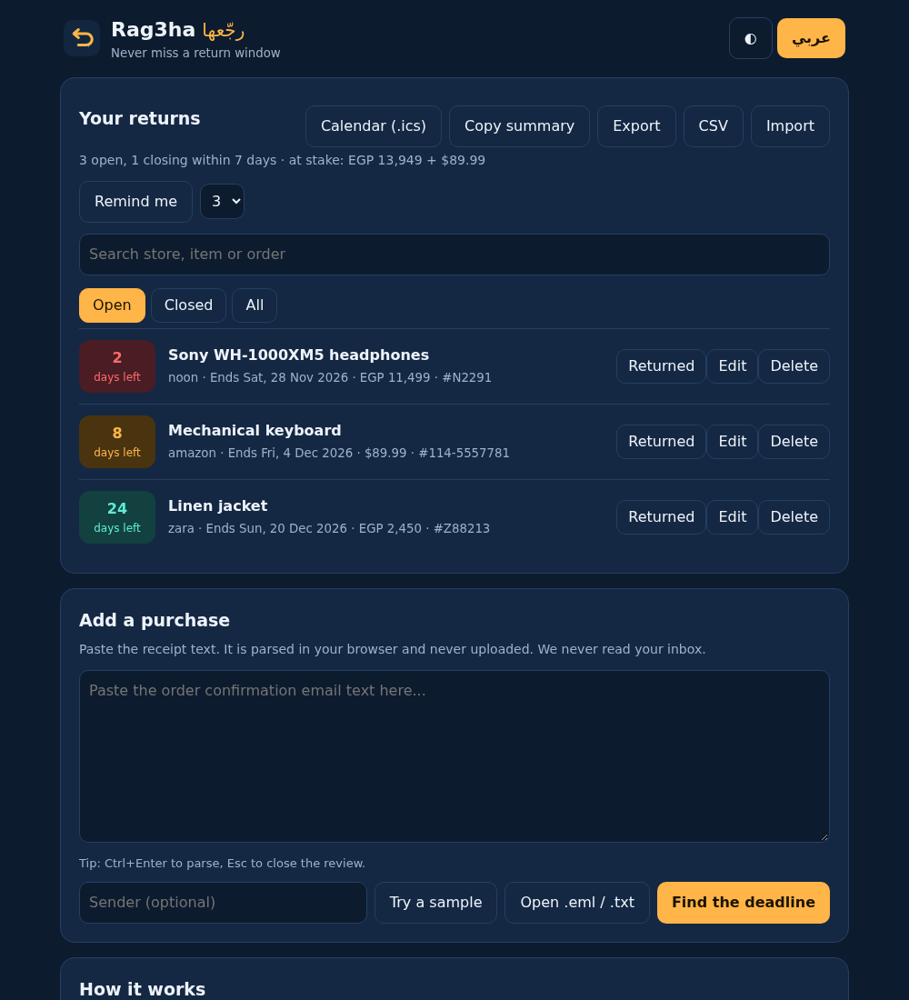
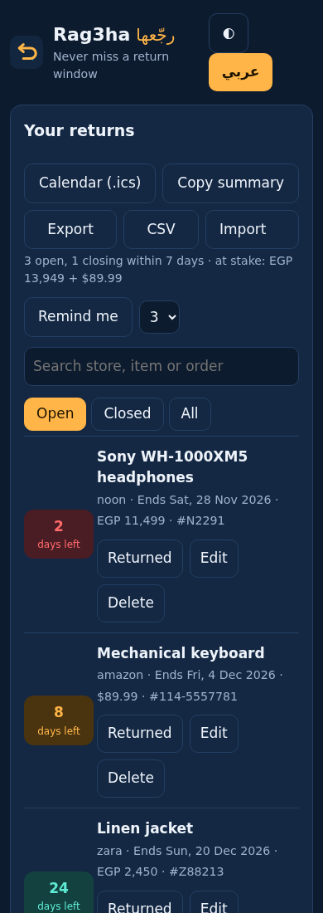
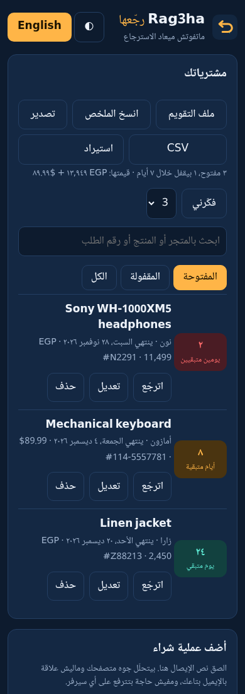
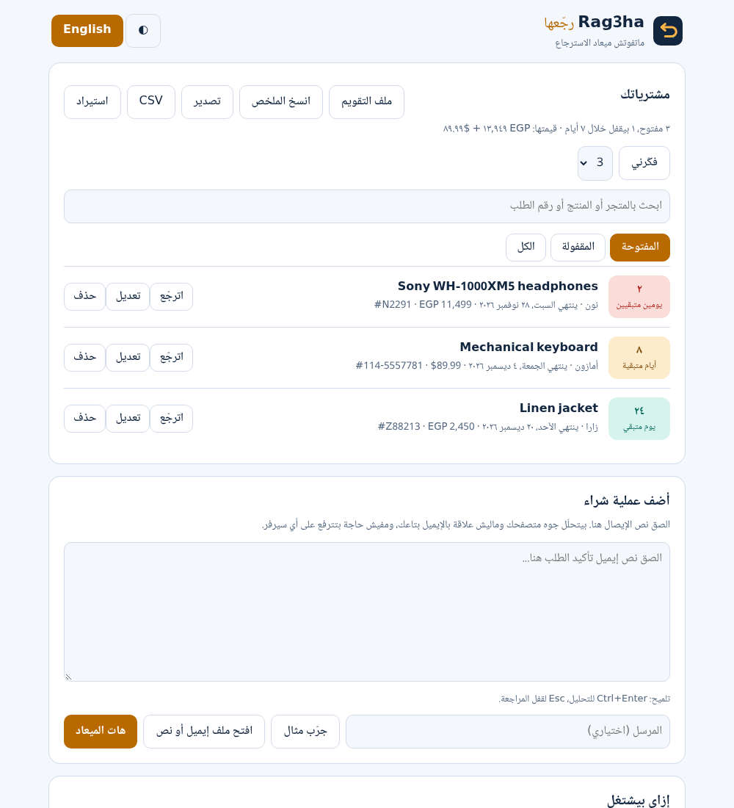

<div align="center">


# Rag3ha | رجّعها

**Paste a receipt, get the return deadline. Free, private, English and Arabic.**

[**Live demo**](https://yousefkhames.github.io/rag3ha/) · [Report an issue](https://github.com/yousefkhames/rag3ha/issues) · MIT License



</div>

## Why
Return windows close quietly. Most trackers ask for access to your inbox or an account. Rag3ha does the one useful thing: you paste the receipt text, it works out the deadline, shows a countdown and can put it in your calendar. Nothing leaves your browser.

## Screenshots
| Mobile (English) | Mobile (Arabic, RTL) | Desktop (Arabic, light) |
|---|---|---|
|  |  |  |

## Features
- Reads an explicit "return by" date when the receipt has one, otherwise store, purchase or delivery date, total, item, order number and "N days" return phrases (Arabic digits supported).
- Falls back to a default return window per store (about 40 stores, including noon, Jumia, Amazon.eg, B.TECH) and tells you when it did.
- Review screen before saving: fix the date or window if the store's policy differs.
- Countdown colours (green, amber at 10 days, red at 3), open / closed / all filters, edit, mark returned, delete with undo.
- Paste several receipts at once (separated by `---`) or import `.eml` / `.txt` files.
- Search, "at stake" totals per currency, duplicate detection, remembered per-store windows, CSV and plain-text summary export.
- Calendar export (`.ics`) with a 3-day alert, JSON export/import, optional browser reminders.
- English and Arabic (RTL, Arabic-Indic digits), light and dark theme, installable offline PWA.
- Accessible: skip link, labelled fields, live regions, visible focus, reduced-motion support.
- Strict Content-Security-Policy: the page cannot make requests to other sites.

## Tech stack
Plain HTML, CSS and JavaScript (no framework, no build step, no dependencies). The parser is a pure module (`docs/parser.js`) shared by the app and the tests. Optional zero-dependency Node server in `server/`.

## Run it
```bash
git clone https://github.com/yousefkhames/rag3ha && cd rag3ha
npm start            # http://localhost:8080 (or just open docs/index.html)
npm test             # unit tests + real-browser click-through (needs Google Chrome)
bash tests/shots.sh  # regenerate the README screenshots
```
The `docs/` folder is the whole site and is what GitHub Pages serves.

## Testing
`test.js` covers the parser. `tests/run-e2e.sh` drives the real app in headless Chrome at 1200, 390 and 320 px in English and Arabic: add from a receipt, edit, mark returned, filter, delete and undo, multi-receipt paste, calendar export, and a no-horizontal-scroll check.

## Honest limits
- It does not connect to Gmail or Outlook. That would need OAuth and a server you trust, so it is not included. You paste or import the text.
- Parsing is rule-based. Always check the review screen: store policies change, and a window the receipt does not state is only a default.
- Data is stored in your browser (localStorage). Clearing site data deletes it; use Export to back up.
- Reminders only fire while the app is open; there is no push server.
- Store names are matched by keyword, so unfamiliar stores fall back to a generic 30-day window.

## License
MIT. See [LICENSE](LICENSE).
